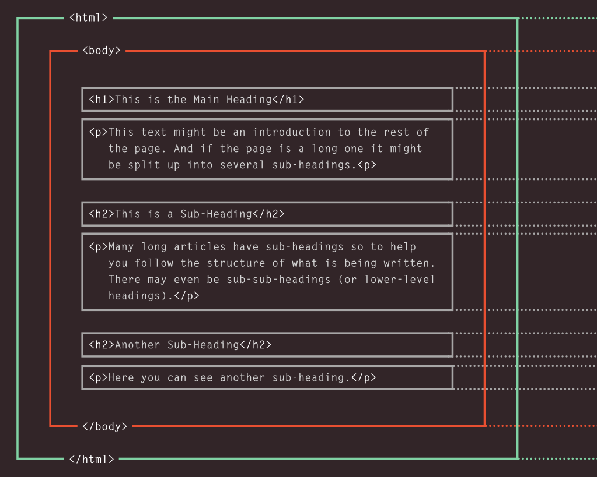

# Elements and Page Structure

An HTML page is made from elements. An element tells the browser what a piece of content is, so a paragraph is marked as a paragraph and a heading is marked as a heading.

This chapter covers the parts of an element, how elements nest, and the skeleton that every HTML page needs.

## Tags, content, and elements

A paragraph looks like this:

```html
<p>Fresh bread is baked every morning.</p>
```

It has three parts:

```text
<p>                                  opening tag
Fresh bread is baked every morning.  content
</p>                                 closing tag
```

The opening tag names the element. The content sits between the tags. The closing tag has a forward slash and marks the end. All three together make the element.

Use lowercase element names. `<P>` usually works, but lowercase is easier to read and matches the rest of the examples.

### Elements without closing tags

Some elements do not wrap content, so they have no closing tag:

```html

<br>
<hr>
<input type="text">
```

These are called void elements. You may see a trailing slash such as `<br />` in older code. HTML does not require it.

### Elements that contain other elements

Elements can contain other elements:

```html
<p>
  This loaf is <strong>still warm</strong>.
</p>
```

The `<strong>` element sits inside the `<p>` element. This is called nesting. When you nest elements, close them in the reverse order you opened them:

```html
<p>
  <strong>Correct</strong>
</p>
```

Do not cross the tags:

```html
<p>
  <strong>Incorrect</p>
</strong>
```

The rule is: last opened, first closed.

## Attributes

An attribute gives the browser extra information about an element. Attributes go in the opening tag and usually have a value:

```html
<a href="menu.html">See the menu</a>
```

- `href` is the attribute name.
- `"menu.html"` is the attribute value.
- The value is written in quotes.

An element can have more than one attribute:

```html

```

Attribute names are lowercase by convention. Use double quotes and keep the value inside them.

## The page skeleton

Every page starts with the same basic structure:

```html
<!doctype html>
<html lang="en">
<head>
  <meta charset="utf-8">
  <meta name="viewport" content="width=device-width, initial-scale=1">
  <title>MHSM Bakery</title>
</head>
<body>
  <h1>MHSM Bakery</h1>
  <p>Fresh bread is baked every morning.</p>
</body>
</html>
```

Here is what each part does.

### `<!doctype html>`

The doctype tells the browser to use standards mode. Put it on the first line, before anything else.

### `<html>`

The `<html>` element wraps the whole document. The `lang` attribute tells browsers and screen readers which language the page uses:

```html
<html lang="en">
```

Use `en` for English. The closing `</html>` goes at the end of the file.

### `<head>`

The `<head>` contains information about the page. Most of it is not visible in the page body.

```html
<head>
  <meta charset="utf-8">
  <meta name="viewport" content="width=device-width, initial-scale=1">
  <title>MHSM Bakery</title>
</head>
```

- `<meta charset="utf-8">` lets the browser display characters such as `é`, `–`, and `€` correctly. Include it on every page.
- `<meta name="viewport" ...>` tells mobile browsers to use the device width instead of zooming out. Include it on every page.
- `<title>` sets the text in the browser tab. It is also used in bookmarks and search results.

### `<body>`

The `<body>` contains the content visitors see: headings, paragraphs, images, links, lists, tables, and forms.

```html
<body>
  <h1>MHSM Bakery</h1>
  <p>Fresh bread is baked every morning.</p>
</body>
```

Each page has one `<body>`, and it comes after `<head>`.

<figure markdown="span">
  
  <figcaption>The page structure: html wraps head and body</figcaption>
</figure>

## Check your work

After you write a page, open it in a browser and look for these problems:

- **The page is blank.** Check that the content is inside `<body>` and that you saved the file with an `.html` extension.
- **The tags appear as text.** Check the file extension. A `.txt` file will not be rendered as a web page.
- **The text looks garbled.** Check that `<meta charset="utf-8">` is inside `<head>`.
- **The page is too wide on a phone.** Check that the viewport meta tag is inside `<head>`.
- **Part of the page is missing.** Check that each non-void element has a closing tag, and that tags do not cross each other.

## Try it

1. Create a folder called `practice`.
2. Inside it, create a file called `index.html`.
3. Type the page skeleton from this chapter, using your own title and two paragraphs about something you know well.
4. Add a `<strong>` element around one important phrase.
5. Open the file in your browser. If you change the file, save it and reload the browser.

Keep this file. The next chapters add to it.

Next: [Headings](02-headings.md) shows how to outline a page.
