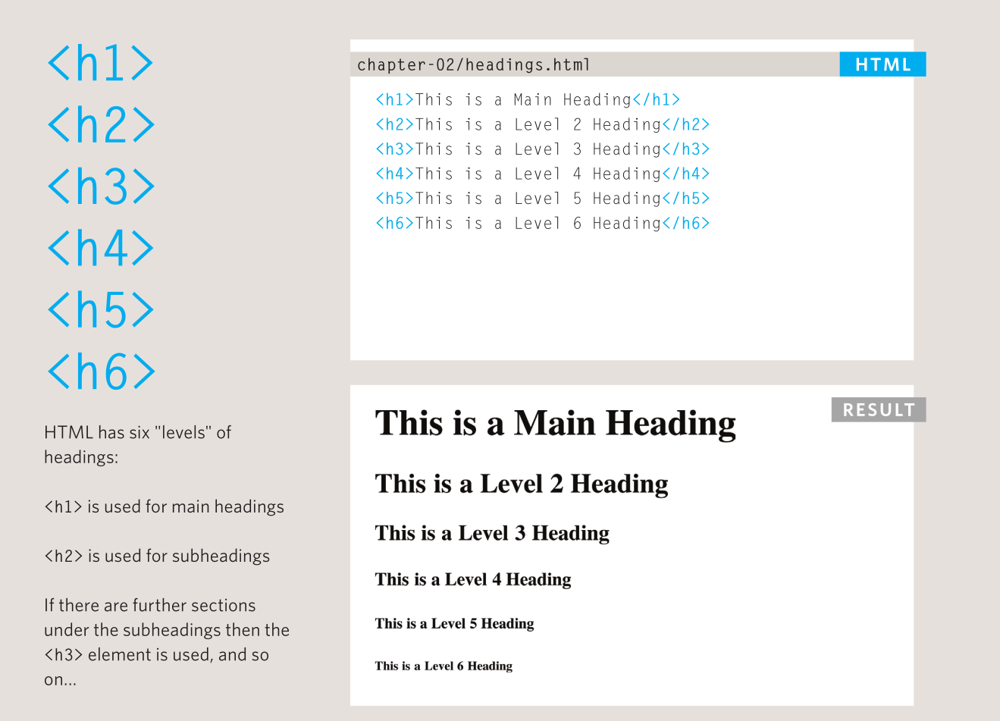

# Heading Levels

This page is a quick reference for `<h1>` to `<h6>`. Use it when you need to check which level belongs where.

## The six levels

| Tag | Use | Example |
|-----|-----|---------|
| `<h1>` | Page title, once per page | MHSM Bakery |
| `<h2>` | Major section | Our Menu |
| `<h3>` | Subsection inside an `<h2>` | Drinks |
| `<h4>` | Deeper subsection | Hot Drinks |
| `<h5>` | Rarely needed | Tea Notes |
| `<h6>` | Rarely needed | Fine Print |

The browser's default size is not a reason to choose a level. The outline is.

<figure markdown="span">
  { width="400" }
  <figcaption>Default heading sizes, largest to smallest</figcaption>
</figure>

## A correct outline

```html
<h1>Bakery</h1>
  <h2>Menu</h2>
    <h3>Bread</h3>
    <h3>Pastries</h3>
  <h2>Prices</h2>
  <h2>Contact</h2>
```

This outline is valid even though it does not use `<h4>`, `<h5>`, or `<h6>`. Use only the levels your content needs.

## An outline with a problem

```html
<h1>Bakery</h1>
  <h3>Menu</h3>
  <h3>Prices</h3>
```

The page jumps from level 1 to level 3. A screen reader user will hear a gap in the structure, and the page will be harder to scan.

## Exercise: fix the outline

The headings below are out of order. Rewrite them so they form a sensible outline with one `<h1>`, the main sections as `<h2>`, and the items under `Bread` as `<h3>`.

```html
<h1>MHSM Bakery</h1>
<h3>Bread</h3>
<h4>White bread</h4>
<h4>Brown bread</h4>
<h3>Pastries</h3>
<h2>Contact</h2>
```

When you have rewritten it, check:

- Is there exactly one `<h1>`?
- Does every `<h3>` sit under an `<h2>`?
- Does each heading describe the content below it?

## Quick rules

- One `<h1>` per page.
- Do not skip levels.
- Do not use headings just to make text bigger.
- Keep heading text short and descriptive.
- Use CSS to change appearance.

Next: [Paragraphs](04-paragraphs.md)
