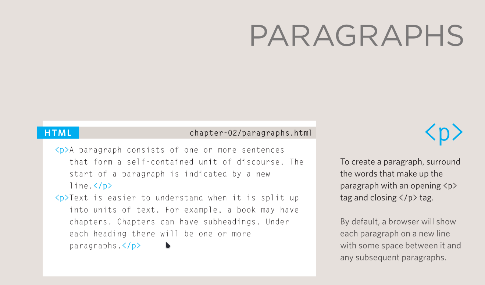

# Paragraphs

A paragraph is a block of text about one idea. HTML marks it with `<p>`:

```html
<p>Fresh bread is baked every morning.</p>
```

Browsers put a paragraph on its own line and add space above and below it. Keep each paragraph short enough to read on a phone. If you start a new idea, start a new paragraph.

## `<p>` and `<br>`

`<p>` starts a new block. `<br>` breaks a line inside the same block.

```html
<p>
  MHSM Bakery<br>
  Migadde, Uganda<br>
  Open 7am to 6pm
</p>
```

Use `<br>` for addresses, poems, song lyrics, or short lines that belong together. Do not use several `<br>` elements to create space between paragraphs:

```html
<!-- Avoid -->
<p>Menu</p>
<br><br><br>
<p>Prices</p>
```

That creates no real spacing in the document structure, and screen readers do not treat the blank lines as meaningful. Use separate paragraphs and CSS margins instead.

<figure markdown="span">
  { width="400" }
  <figcaption>Paragraphs create blocks; br creates a line break inside one block</figcaption>
</figure>

## `<hr>` marks a change of topic

An `<hr>` is a thematic break. It separates sections when the topic changes, such as moving from a menu to prices or from one scene in a story to another.

```html
<p>Our menu changes with the season.</p>
<hr>
<p>Prices include tax.</p>
```

The browser draws a line, but the line is not the point. The break in the content is.

Do not use `<hr>` as decoration. If you want a line for visual reasons, use a border in CSS.

## Check your work

- Does each paragraph contain one main idea?
- Are there any groups of two or more `<br>` elements used for spacing?
- Does `<hr>` separate two genuinely different topics?
- Is all the text inside `<p>` or another suitable element, rather than loose in `<body>`?

## Try it

Mark up a shop notice with:

- a heading,
- two paragraphs about opening hours,
- an address written with `<br>`,
- an `<hr>` before a note about holiday closing times.

Open the page in the browser and resize the window. The line breaks in the address should stay; the paragraphs should wrap normally.

Next: [Text Blocks](05-paragraphs-snippets.md) gives the exact syntax for `<p>`, `<br>`, and `<hr>`.
